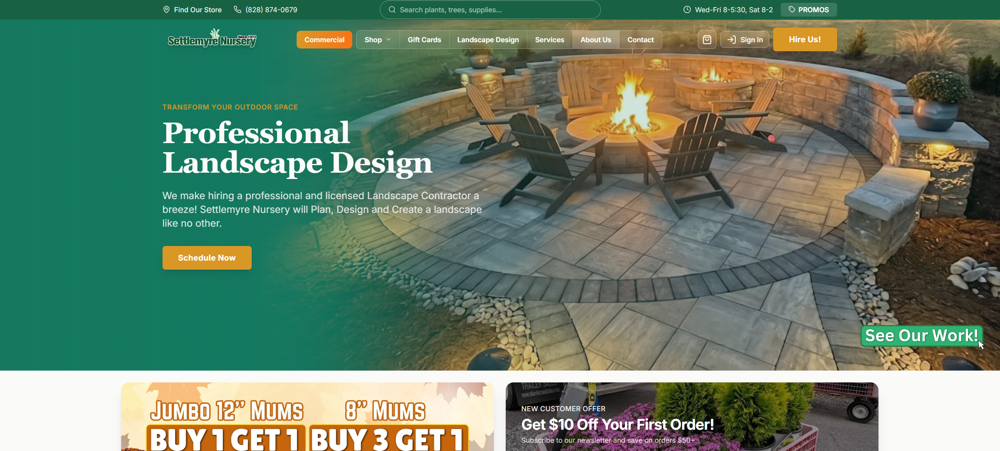
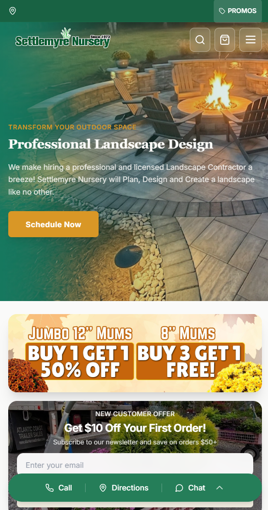
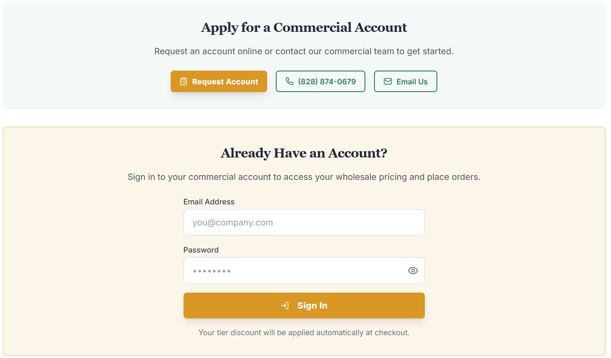
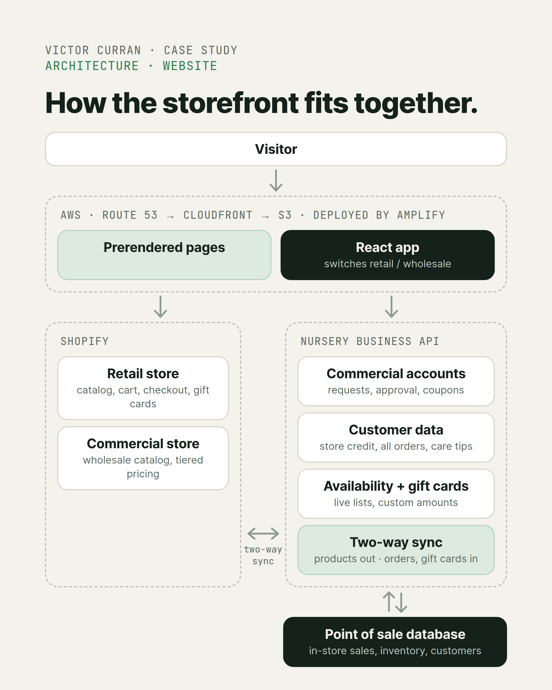
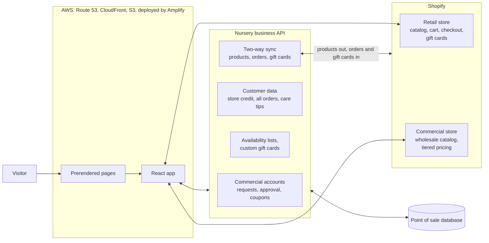
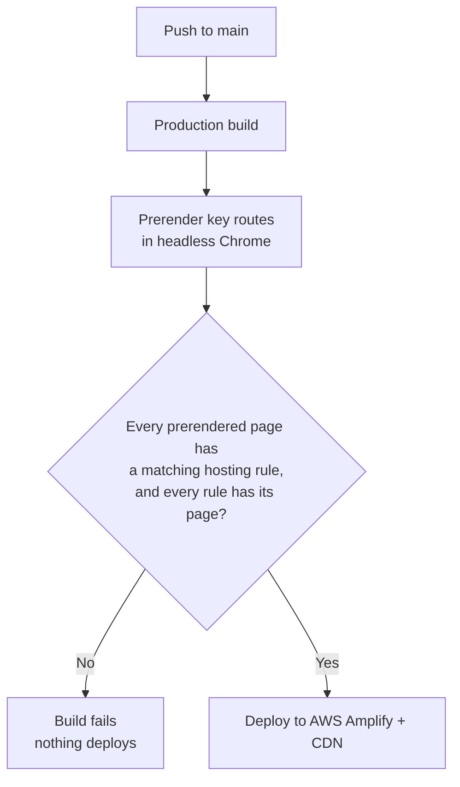
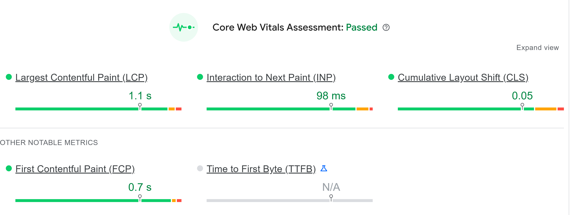

# Headless Storefront: One React Codebase for Retail and Wholesale

*Built for [Settlemyre Nursery](https://settlemyrenursery.com).*

**Role:** Sole engineer on the website (design, build, deployment, support). The business API and sync it connects to are a shared system I contribute to.

**Frontend:** React, TypeScript, Vite, Tailwind CSS, shadcn/ui (Radix), TanStack Query, React Router, React Hook Form + Zod

**Commerce:** Shopify Storefront API (two stores), Shopify Customer Account API (OAuth + PKCE)

**Infrastructure:** AWS Amplify (CI/CD and hosting), CloudFront, S3, Route 53, Certificate Manager, CloudWatch

**Build:** Puppeteer prerendering, build-time hosting rule verification

**Status:** Live at [settlemyrenursery.com](https://settlemyrenursery.com)

> This is a case study, not the source code. The production repo is private and belongs to Settlemyre Nursery.

---

  
  

## Overview

Settlemyre Nursery is a family-owned garden center and landscaping business. Its website ran on a Shopify theme that had been customized for years, to the point where the theme's CSS alone was past 33,000 lines. Every change was slow and risky.

I replaced it with a headless storefront that runs two Shopify stores, retail and wholesale, from one React codebase, deployed on AWS. It sits on top of two systems. Shopify handles the catalog, cart, checkout, and payments for both a retail and a wholesale store. The nursery's integration system connects the site to the point of sale system, so customers see their in-store purchases, store credit, and real availability online. That integration system existed before this project and was built by other developers. I extend and maintain it, and the website is mine end to end.

## The problem

- **Two very different customers.** Retail shoppers and commercial buyers (landscapers and contractors) need different products, different pricing, and different ways to sign in.
- **A theme nobody wanted to touch.** Small design changes meant digging through years of overrides.
- **An online store disconnected from the real store.** Most of the business happens at the register. Store credit, in-store purchases, and what was actually on the lot were invisible online.

## Key decisions

### 1. Headless instead of another theme

Rebuilding the theme would have been faster to start, but it would have kept every limitation of the theme system. Going headless meant full control over design, performance, and features, while keeping Shopify for the parts it does best. The tradeoff: anything a theme does for free, like SEO and old URL handling, became my job. More on that below.

### 2. A real wholesale side, not just a price list

Commercial customers get their own Shopify store with a wholesale catalog and tiered pricing. The site starts in retail mode, and when a commercial customer signs in, the whole site switches to the wholesale store.

Commercial accounts don't use Shopify's customer accounts. They run through the nursery's own account system, because wholesale access has to be earned:

- A business **requests an account**, and the nursery **approves it** before it can see wholesale pricing.
- Approved customers sign in with their own credentials, with sessions that refresh in the background and a self-serve password reset.
- Commercial customers can **generate coupons** and see a **wholesale availability list** that's separate from the retail one.

Retail customers sign in through Shopify's own customer accounts. One codebase serves both audiences instead of two sites drifting apart.

**How the switching works.** The app decides which store it's talking to in a fixed order: the dedicated commercial subdomain always means wholesale, then a saved store preference, then retail as the default. The subdomain can't be overridden, so a wholesale link always opens the wholesale store. When the mode changes, the app broadcasts a store change, and the Shopify client, product data, and cart all switch to the active store. Signing out resets everything back to retail.

  

### 3. Connecting the website to the register

The nursery's business API is the bridge between the website and the point of sale system. Through it, the site can show:

- **Store credit** on the customer's account
- **One order history** that merges online orders and in-store purchases, labeled by where each happened
- **Plant care tips** based on what the customer actually bought
- **Live availability** lists for retail and commercial customers
- **Custom-amount gift cards:** preset amounts are regular Shopify products, and any other amount goes through the API, which emails the buyer an invoice

On top of that history, the account page adds purchase insights, a wishlist, and quick reordering for items sold online.

<!-- SCREENSHOT: Account page order history showing online and in-store orders with their channel labels. Use a test account, or blur the name, email, order numbers, and amounts. -->

  

### 4. Keeping the website and the register in sync

The nursery's real data lives in the point of sale system, so the website is only as good as its connection to it. The nursery's integration system keeps the two in step in both directions:

- **Products, inventory, and collections** flow from the point of sale system into both Shopify stores, each with its own catalog.
- **Online orders** flow back into the point of sale system, so every sale ends up in one place.
- **Gift cards bought online** are recorded in the point of sale system's gift card records, so customers can redeem them at the register.

Product browsing reads from Shopify, which means website traffic never puts load on the register's database.

### 5. Never breaking an old link

Years of search rankings and shared links pointed at the old theme's URLs. I mapped them into around 200 hosting-level redirect rules, plus in-app redirects that resolve old collection and product URLs (including variations like missing hyphens) to their new homes.

## The hardest problem: SEO in a single page app

A React single page app sends the same nearly empty HTML shell for every URL and fills in the content with JavaScript. All of the page titles, descriptions, and structured data I'd written were only added after that JavaScript ran. Google does render JavaScript, but on a delayed second pass. Bing and AI answer engines mostly don't. To most crawlers, the site was blank.

The fix was a build step that prerenders the important pages:

- During each build, a headless Chrome instance visits every key route and saves the fully rendered HTML.
- The app still boots normally on top of that HTML, so nothing changes for visitors.
- The root page stays as the empty shell on purpose. It's the fallback for routes that aren't prerendered, and baking the homepage into it would have given every product page the homepage's canonical URL. That would have been worse than doing nothing.

Then I added a guardrail. Each prerendered page needs a matching hosting rule, and a rule without its page takes a live URL down with a 404. A verification script now fails the build if the two ever drift apart, so that mistake can't ship.

## Other things worth mentioning

- **Tiered cart discounts** with a progress bar that correctly leaves sale items out of the calculation
- **Site-wide search** with recent and trending searches, built to fall back to a simple search bar instead of disappearing if anything goes wrong
- **An AI chat assistant** for customer questions that links straight to relevant pages and offers a way to reach a person after a few exchanges

## Infrastructure

| Service | What it does here |
|---------|-------------------|
| **AWS Amplify** | Builds every push, runs the prerender and verification steps, and deploys. Also holds the rewrite and redirect rules, including the ~200 legacy URL redirects. |
| **CloudFront** | CDN in front of every page and asset |
| **S3** | Stores each build's output |
| **Route 53** | DNS for the main domain and the commercial subdomain |
| **Certificate Manager** | SSL certificates, provisioned and renewed automatically |
| **CloudWatch** | Monitoring |

## Architecture

  

### Zoom in: the build pipeline

The check exists because a hosting rule pointing at a page that wasn't prerendered returns a 404 for a live URL. Catching it in the build means that mistake can't reach production.

## Results

- Replaced a theme that had grown past 33,000 lines of CSS with a maintainable React codebase
- Retail and wholesale customers served from one site, with a full approval-based account system for commercial buyers
- Store credit and complete purchase history, online and in store, in one customer account
- Key pages now serve real, crawlable HTML to every search engine
- **Passes Google's Core Web Vitals on real visitor data**, despite video-heavy pages:

| Metric | Result | What it means |
|--------|--------|---------------|
| Largest Contentful Paint | 1.1 s | Main content is visible in about a second |
| Interaction to Next Paint | 98 ms | Taps and clicks respond almost instantly |
| Cumulative Layout Shift | 0.05 | The page doesn't jump around while loading |
| First Contentful Paint | 0.7 s | Something useful appears in under a second |

  

<!-- Optional: organic traffic change, online order growth. -->

## What I learned

Going headless means you inherit everything the platform used to handle for you. SEO, redirects, accounts for customers the platform wasn't built for, and the connection back to the business's real systems all become your problem the moment you leave the theme. The other lesson: when a mistake can take a live page down, a check in the build beats remembering to be careful.

---

**Victor Curran** · [GitHub](https://github.com/sn-Victor) · [LinkedIn](https://linkedin.com/in/victor-curran)
